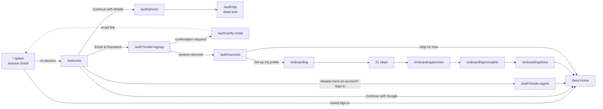

# Route, journey and screen audit — Lovable app

**Date:** 13 Sep 2026 · **App commit:** `a6dc3d0` (main, CI green) · **Scope:** the Lovable app only
(`musiclinkd-9e6ca875`). UX, routes, mapping and components. No content review.

**Method.** The inventory was built three ways, and each check covers gaps the others miss:

- **Static route map.** All 209 routes come from `routeTree.gen.ts`, with every link in the code resolved to one of them.
- **Declaration-level link graph.** A route counts a link only when it actually uses the function or constant that holds it, so a count helper that reads a list doesn't add that list's links.
- **Live requests** to the dev server for every route, using real ids and unknown ids.
- **Line-by-line read** of all 209 route files and the components that decide what each one shows. Seven area passes looked for the hidden screens behind step and mode params, state flags, early returns, sheets and dialogs.

The generator scripts and raw JSON are in `route-audit-2026-09-13/`.

---

## 1. Summary

| | Count |
|---|---|
| Routes (URLs) | **209**. 204 pages, 1 splash, 1 booking layout, 3 legacy redirects |
| Routes a signed-in user can reach from Home | **159** |
| Routes nothing links to, or linked only from other unreachable pages | **35** (§5) |
| Hidden full-view screens inside routes (steps, variants, success, empty/error, not found) | inventoried per route (§6, `screen-inventory.md`) |
| Demo or simulator controls visible in the live UI | **9** (§6.9) |
| Unknown-id URLs that return HTTP 200 instead of a 404 | **22** of 24 tested |
| Broken link targets (link points to a route that doesn't exist) | **0**. Typed links hold. |
| Wrong link targets (route exists, but it's the wrong one) | **20 found**. 2 fixed today, 18 open (§7.1) |

**The five things that matter most**

1. **Nothing links to `/settings`.** Only the Back buttons on its own sub-pages point there, and Settings is the only way into **Business, Services and Sign out**. From Home, the one path is Notifications → a security alert → Security → Back.
2. **The business owner journey is cut in two.** Nothing links to `/business/$id/dashboard`, so it and its 7 sub-pages (leads, analytics, services, availability, portfolio, reviews, verification) can only be opened by typing the URL. Creating a business saves nothing and lands on the list.
3. **Booking from a service or business page always fails.** "Book" opens `/booking/svc-1`, but the booking flow only knows space ids, so every entry except "Book again" shows *This space is unavailable*.
4. **Sign-up skips onboarding** for Google and for email-link users, and **phone sign-in can't succeed**: *Verify* always says the code didn't match.
5. **Account type isn't part of the journey.** "Do you represent a business?" and "Are you in a band?" are steps 20–21 of 21, stored in `discovery_prefs`, and nothing after onboarding reads them. Home, Profile and navigation are identical for every account type.

---

## 2. App start (changed today)

**Commits:** `c17c96d`, `9c1e1a7`, `e53a451`.

- `/` renders the brand mark, then replaces itself with `/feed` or `/welcome`. It is not Discover.
- Discover moved to `/discover`.
- Signed-out "Sign in" prompts open `/welcome`.

**Still wrong in this flow**

| Defect | Where |
|---|---|
| **Google sign-in** goes straight to Home, so a new Google user never sees onboarding | `welcome.tsx:129`, `auth.index.tsx:126` |
| **The email confirmation link** returns to `/`, which routes to Home, so onboarding is skipped | `auth.index.tsx:91` (`emailRedirectTo` = origin) |
| **The splash** doesn't read `profiles.onboarding_complete` | `index.tsx:28` |
| **Phone sign-in:** *Verify* always shows *That code did not match* | `auth.otp.tsx:97-99` |
| **Nothing on Home resumes an unfinished onboarding.** `/onboarding/resume` exists, but only `/onboarding` links to it | `onboarding/index.tsx:87` |
| **Rate-limit and network errors show inline.** `/auth/locked` and `/auth/offline` are never used | `components/ml/auth.tsx:303-316` |

---

## 3. Account type

**What exists**

- **Onboarding steps 20 and 21:** `business` ("Do you represent a business?", with a type from `businessTypes`: Studio, Label, Agency, Venue, Dealer, Rental Provider, Music School, Production House, Other) and `band` ("Are you in a band or crew?"). Both are optional and come last (`data/onboarding.ts:777,792`).
- **Where the answers go:** `profiles.discovery_prefs.businessIntent` and `.bandIntent` (`lib/profile-map.ts:75-79`).
- **The only thing that reads them:** `/onboarding/complete`, which shows a hand-off card. Business goes to `/business/new` (fixed today; it opened `/categories`) and band goes to `/bands/new`.
- **Steps 1–19 are individual-talent questions** (role, instruments, genres, specialisation…) and are asked of everyone.
- **The seeded business accounts** (`sunsetrecords`, `thequarter`, `octave-sound-labs`, `northlightfilms`) are ordinary `profiles` rows.
- **No `account_type` column exists.** Businesses (`/business/*`) and bands (`/bands/*`) are mock data, not linked to the signed-in account.

**Owner decision (13 Sep): a band is not an account type.** Band setup can happen any time after
registration, so `/bands/new` needs a permanent entry point for any signed-in user, not only the
onboarding hand-off card. The step-21 band question stays an optional nudge.

**What's missing (decisions for you, §8)**

- Where the type is chosen: at registration, or as the first onboarding step.
- Which onboarding steps each type sees.
- What Home, Profile and the bottom nav show per type.
- Where "my business" / "my band" live once they exist.

---

## 4. Journeys by user type (signed in, starting at Home)

Every hop below is a real link, with its `file:line`. **✗** means no path exists from Home.

### Talent (individual)

| Destination | Hops | Path |
|---|---|---|
| Profile `/me` | 1 | Home → Profile tab |
| Edit profile | 1 | Home → `/profile/edit` (`feed.tsx`) |
| Portfolio / add work | 1–2 | Home → `/portfolio/new` → `/portfolio` |
| Find work / apply | 1–3 | Home → `/opportunities` → `/opportunities/$id` → apply |
| My applications | 1 | Home tile → `/opportunities/applications` |
| Collaborations | 2 | Home → For you → `/collab` |
| Booking requests (provider) | 2 | Home → Notifications → `/provider/bookings/requests` |
| My services `/services` | **4** | Home → Notifications → Security → Settings → Services |
| Manage a service `/services/$id/manage` | **✗** | nothing links here |
| Verification | 2 | Home → Profile → owner panel (`person-profile.tsx:206`) |
| QR / identity | 2 | Home → Profile → owner panel (`person-profile.tsx:205`) |
| Earnings | 2 | Home → `/plans` → `/plans/earnings` |
| Reply to a review `/reviews/$id/reply` | ✗ | `/reviews` uses an inline composer instead |
| Profile insights `/profile/insights` | ✗ | Profile "Stats" opens an inline panel instead |

### Hirer / client

| Destination | Hops | Path |
|---|---|---|
| Discover, Search, For you | 1 | bottom nav / Home |
| Talent profile | 1 | Home card → `/profile/$username` |
| Post an opportunity | 2 | `/opportunities` → `/opportunities/new` |
| Review applicants | 3–4 | `/opportunities` → Mine → Applicants → applicant |
| Book a studio `/booking/$id` | 2 | only Bookings → a completed booking → "Book again". **Every "Book" button on services, business and applicant pages opens `/booking/svc-1` → *This space is unavailable*** |
| Pay deposit | via the funnel | service → schedule → details → add-ons → review → pay → confirmed |
| Write a review | 2 | `/reviews` → To review |
| Enquire about a service `/services/$id/enquiry` | ✗ | nothing links here |
| Enquire with a business `/business/$id/enquiry` | ✗ | nothing links here |
| "Why am I seeing this" `/search/why/$id` | ✗ | nothing links here |

### Band member

| Destination | Hops | Path |
|---|---|---|
| Bands / create band | 1–2 | Home → `/bands` → `/bands/new` (saves nothing) |
| Band profile, manage, invite | 2–3 | `/bands` → band → Manage / Invite |
| Band contact `/bands/$id/contact` | ✗ | band "Message" opens `/messages` instead |
| Band shows `/bands/$id/events` | ✗ | nothing links here |
| Band portfolio `/bands/$id/portfolio` | ✗ | band "Band portfolio" row opens the personal `/portfolio` instead |

### Business owner

| Destination | Hops | Path |
|---|---|---|
| My businesses `/business` | **4** | Home → Notifications → Security → Settings → Business |
| Create business | 5, or from onboarding complete | …→ `/business/new`. Saves nothing, and "Open business" goes to the list |
| Business profile / manage / team | 5–6 | …→ `/business/$id` → Manage / Team |
| **Dashboard and 7 sub-pages** | **✗** | no link anywhere. Only back arrows from analytics and leads point at it |
| Service conflicts `/services/conflicts` | ✗ | nothing links here |
| Provider availability / pricing | 3 | via `/opportunities/new` or `/provider/bookings` |

`/business/$id/manage` also has problems:

- "Details" opens the create wizard (`:65`).
- The TopBar back link has no params (`:44`).
- Verification goes to `/verification/choose`, not the business's own verification page.

### Seller / rental provider

| Destination | Hops | Path |
|---|---|---|
| Sell an item | 2 | Market tab → Sell. No success screen, and the new listing never appears in Mine |
| My listings, offers | 2 | Market → Mine |
| Rentals hub `/marketplace/rent` | **2, via a profile** | Home → a profile → rent row (`data/profile.ts:520`). **The Market tab never links to Rent**; the only other entry is inside the booking flow (`booking.tsx:473`) |
| List equipment, requests, active rental | 3–4 | Rent → List / Listings / Mine |

### Everyone

| Destination | Hops | Path |
|---|---|---|
| Notifications | 1 | Home bell |
| **Settings** | **3** | Home → Notifications → Security → Back |
| **Sign out** | **4** | …→ Settings → Sign out |
| Help, Plans | 1 | Home |
| Search history / saved searches | ✗ | each links only to the other |
| Recently viewed | ✗ | linked only from search history |
| Discover Music / Projects / Community / Nearby | ✗ | nothing links here |

---
## 5. Routes no user can reach (35)

These routes are unreachable from both starts: signed in from Home, and the new-user sign-up flow. Some have
incoming links, but only from pages that are unreachable themselves.

| Route | Links pointing here |
|---|---|
| `/band` | none · legacy redirect → `/bands` |
| `/recently-viewed` | `/search/history` — themselves unreachable |
| `/recommended` | none · legacy redirect → `/recommendations/swipe` |
| `/reset-password` | none |
| `/auth/locked` | none |
| `/auth/maintenance` | none |
| `/auth/offline` | none |
| `/discover/community` | none |
| `/discover/music` | none |
| `/discover/nearby` | none |
| `/discover/projects` | none |
| `/profile/insights` | none |
| `/reviews/request` | none |
| `/search/history` | `/search/saved` — themselves unreachable |
| `/search/saved` | `/search/history` — themselves unreachable |
| `/services/conflicts` | none |
| `/talent/$id` | none · legacy redirect → `/profile/$username` |
| `/bands/$id/contact` | none |
| `/bands/$id/events` | none |
| `/bands/$id/portfolio` | none |
| `/business/$id/analytics` | `/business/$id/dashboard` — themselves unreachable |
| `/business/$id/availability` | `/business/$id/dashboard`, `/business/$id/services` — themselves unreachable |
| `/business/$id/dashboard` | `/business/$id/analytics`, `/business/$id/leads` — themselves unreachable |
| `/business/$id/enquiry` | none |
| `/business/$id/leads` | `/business/$id/dashboard` — themselves unreachable |
| `/business/$id/portfolio` | `/business/$id/dashboard` — themselves unreachable |
| `/business/$id/reviews` | `/business/$id/dashboard` — themselves unreachable |
| `/business/$id/services` | `/business/$id/availability`, `/business/$id/dashboard` — themselves unreachable |
| `/business/$id/verification` | `/business/$id/dashboard` — themselves unreachable |
| `/reviews/$id/edit` | none |
| `/reviews/$id/reply` | none |
| `/reviews/$id/report` | none |
| `/search/why/$id` | none |
| `/services/$id/enquiry` | none |
| `/services/$id/manage` | none |

All four sign-up/onboarding routes you might expect here (`/auth/success`, `/onboarding/*`) are reachable in the
new-user flow (§2). `/reset-password` is reachable only from the password-reset email, which is correct.

---

## 6. Hidden screens inside routes

A **hidden screen** is a full view that replaces a route's default view without changing the URL, or with only a
`?step=`/`?mode=` change. The per-route inventory with `file:line` for every item is in
`route-audit-2026-09-13/screen-inventory.md`. This section keeps what matters for mapping.

### 6.1 Multi-step flows (each step is a screen)

| Flow | Route | Steps | Step lives in |
|---|---|---|---|
| Onboarding | `/onboarding/step/$id` | 21 steps. `instruments` shows only for musician, producer, composer or music teacher. `specialisation` shows only for roles that have one. Required steps: identity, role, location, visibility. | URL param |
| Create business | `/business/new` | type → basics → location → spaces → team → review, then the *Business created* dialog | `?step=` |
| Add a service | `/services/new` | category → basics → pricing → delivery → review, then the *Service published* dialog | `?step=` |
| Post an opportunity | `/opportunities/new` | basics → location → availability → compensation → requirements → preview → published | `?step=` |
| Apply to an opportunity | `/opportunities/$id/apply` | portfolio → message → review → done | `?step=` |
| Verification | `/verification/$type` | Status view (verified / in review / needs changes / expired / locked). The 5-step wizard shows only with `?mode=new` | `?mode=&step=` |
| Book a space | `/booking/$id/*` | entry → service → schedule → details → add-ons → review → pay → confirmed | URL segments |
| Rental request | `/marketplace/rent/request/$id` | dates → summary → request → confirmed | state |
| Rent out equipment | `/marketplace/rent/list` | category → media → details → availability → review → live | state |
| Sell an item | `/marketplace/sell` | type → photos → details → preview (no success screen) | state |
| Create a band | `/bands/new` | identity → genre & city → members → preview, then the *Band created* dialog | state |
| Collaboration | `/collab/new` → `/collab/new/collaborators` | 2 steps. Step 1's input is not carried to step 2 | URL |
| Add work | `/portfolio/new` → `/portfolio/new/$kind` | type picker, then a form for one of 10 kinds (track, album, video, performance, project, client, case-study, writing, image, link) | URL |
| Checkout | `/plans/checkout` | form → processing → *{Plan} is active* dialog | state |

### 6.2 Role and ownership variants on one URL

| Route | Variants |
|---|---|
| `/me` vs `/profile/$username` | Owner view (Edit / Share / Stats / Public, owner panel, owner empty states with add buttons) vs visitor view (Connect / Message / Hire / Follow, More sheet). **Your own `/profile/<you>` shows the visitor view.** 5 tabs: Overview, Portfolio, Projects, Services, About |
| `/bands/$id` | Owner (Manage, Invite) vs visitor (Follow, Message) |
| `/business/$id` | **No owner/visitor split.** Everyone sees the Manage cog |
| `/collab/proposals/$id` | Received (Accept / Decline / Counter) vs sent (Withdraw / Edit). The sent view is unreachable (§6.7) |
| `/opportunities/$id` | Open / already applied / closed. Closed never occurs in the data |
| `/opportunities/$id/applicants/$aid` | New vs shortlisted (Hire replaces Shortlist) |
| `/marketplace/rent/active/$id` | Upcoming / active / completed / cancelled, each with different actions |
| `/bookings/$ref` | Upcoming (today banner) / completed / requested / cancelled |
| `/identity/q/$code` | Profile / business / service / listing / work preview, plus invalid / expired / private / deleted / deactivated |
| `/feed`, `/discover` | Signed-in vs signed-out header avatar |
| `/portfolio`, `/portfolio/new/$kind`, `/profile/edit` | Signed-out card vs signed-in content |

### 6.3 Success and confirmation screens (no URL of their own)

`/bands/$id/contact` sent · `/business/$id/enquiry` sent · `/services/$id/enquiry` question sent / quote sent ·
`/bookings/$ref/cancel` cancelled · `/bookings/$ref/reschedule` sent · `/booking/$id/pay` success / failed ·
`/provider/bookings/requests/$ref` accepted / declined · `/collab/proposals/new` sent ·
`/collab/$id/transfer` transferred · `/collab/$id/remove/$pid` removed · `/collab/$id/lifecycle/$action` done ·
`/reviews/$id/report` sent · `/identity/contact/save` saved · `/auth/forgot` link sent ·
`/reset-password` updated · `/opportunities/new` published · `/opportunities/$id/apply` sent ·
`/marketplace/rent/list` live · `/marketplace/rent/request/$id` confirmed.

### 6.4 Dialogs and sheets that act as screens

These are the ones that end a flow or ask to confirm something destructive:

- **Business:** *Business created* (`business.new.tsx:214`) · *Delete {business}?* then *Business deleted* (`business.$id.manage.tsx:109,131`)
- **Services:** *Service published* (`services.new.tsx:211`) · *Delete "{service}"?* (`services.$id.manage.tsx:107`) · *Manage service* sheet then *Service removed* (`services.$id.index.tsx:159,192`)
- **Bands:** *Band created* (`bands.new.tsx:177`) · *Remove this member?*, *Transfer ownership*, *Delete this band?* (`bands.$id.manage.tsx:179-201`) · *Invitations sent* (`bands.$id.invite.tsx:93`)
- **Opportunities:** *Why are you closing?* then *Opportunity closed* (`opportunities.$id.manage.tsx:124,142`) · *Withdraw this application?* then *Application withdrawn* (`opportunities.applications.$aid.tsx:142,161`) · *Shortlist / decline applicant* confirm, then outcome, then *How do you want to work together?* (`opportunities.$id.applicants.$aid.tsx:135-180`)
- **Plans:** *Why are you cancelling?* then *Subscription cancelled* (`plans.manage.tsx:125,143`)
- **Settings:** *Sign out other devices?* (`settings.security.tsx:84`)
- **Reviews:** *Delete your review?* (`reviews.$id.edit.tsx:82`) · *Review submitted* (`reviews.write.$id.tsx:122`)
- **Contact and hiring:** *Contact professional* then *Request sent* (HireModal: profile, search, studio)
- **Marketplace:** *Make an offer* then *Offer sent*, *Report listing* (`marketplace/l.$id.tsx:219-220`)
- **Collaboration:** upload sheet (idle / uploading / failed / done) on `/collab/$id/files`

### 6.5 Empty, loading, error and offline states that do appear

- **Feed:** offline (`feed.tsx:103`).
- **Identity QR and scanned codes:** loading and offline (`identity.qr.tsx`, `identity.q.$code.tsx`).
- **Identity card:** generating (`identity.card.tsx:37`).
- **Portfolio:** loading, error and empty (`portfolio.index.tsx`, `portfolio.$id.index.tsx`, `portfolio.analytics.tsx`, `portfolio.reorder.tsx`, `portfolio.select.tsx`).
- **Profile edit:** loading, error and signed out (`profile.edit.tsx`).
- **Onboarding steps:** loading, plus sync banners for saving, offline, error and local (`onboarding/step.$id.tsx`).
- **Rent home:** 450ms loading skeleton (`marketplace/rent/index.tsx:37`).
- **Booking requests:** loading after Refresh (`provider.bookings.requests.index.tsx:45`).
- **Nearby:** location permission gate (`discover.nearby.tsx:31`).
- **QR scanner:** camera prompt, blocked and ready (`identity.scan.tsx`).
- **Search:** no-results (help, marketplace, rent, opportunities).
- **Filtered lists:** empty (notifications Unread, collab tabs, services Draft, marketplace Drafts, rent Spaces, help Marketplace/Billing topics).

### 6.6 Not-found handling for unknown ids

Tested live with 24 invalid ids. Two routes return a real **404**: `/profile/$username` and `/verification/$type`. The other **22 return HTTP 200**:

- **15 show an in-page "not found / unavailable" message:** business, business dashboard, services, booking, bookings, bands, band shows, opportunities, opportunity manage, review edit, portfolio edit, marketplace listing, marketplace seller, rent equipment, help article.
- **3 show the wrong state, *You don't have access*:** collab project, collab invitation, collab proposal.
- **4 show no not-found state at all:** `/search/why/$id` (default explanation), `/onboarding/step/$id` ("not part of your setup"), `/portfolio/$id` (blank "Work"), and `/identity/q/$code`. The last is correct, because it is the invalid-code page.

The same code pattern renders for any id, with no not-found state, on `/bands/$id/invite`, `/marketplace/c/$slug`, `/marketplace/rent/c/$slug` and `/opportunities/$id/analytics`. `/provider/pricing` renders blank. Collab has two missing-id views: *You don't have access* on 15 routes and *deleted* on 11.

### 6.7 States that are built but can't appear

**Loading, error or empty with no trigger, because the state flag has no setter or is fixed:**

- **Feed:** loading, error, empty network (`feed.tsx:61`; `emptyDashboard` is unused). `ProfileSkeleton` (`profile.tsx:72`) and `ListingSkeleton` (`market.tsx:321`) are never rendered.
- **Lists:** `/recommendations` loading (`:47`) · `/bands` loading (`:30`) · `/marketplace/rent/search` loading (`:43`)
- **Opportunities:** loading and empty on `/opportunities`, `/opportunities/applications`, `/opportunities/$id/applicants` (`loading` has no setter)
- **Error screens:** `/identity/scan` camera error (`:81`) · `/identity/contact/save` error (`:45`) · `/plans/checkout` payment failed (`:126`)

**Never produced by the seed data:**

- **Empty states:** `/business` · `/business/$id/leads` · `/business/$id/portfolio` · `/business/$id/reviews` · `/services/conflicts` · `/opportunities/mine` · `/opportunities/saved` · `/reviews` (all three tabs) · `/reviews/request` · `/recently-viewed` · `/discover/*` · provider booking empties · rent mine/listings buckets · provider equipment empty
- **Variants:** opportunity *closed* · verification overall states other than *rejected* · verification *locked* · checkout *past due* · payout *pending/missing*

**Unreachable through the flow:**

- **Booking:** *Booking request sent* confirmation (`booking.confirmed.$ref.tsx:40`, the only no-deposit space is instant-only) · schedule *No availability on this date* (`booking.$id.schedule.tsx:122`)
- **Collab:**
  - Only the received proposal is linked (hardcoded `prop-mix`), so sent proposals can't be opened.
  - The accepted invitation's project view can't show, because both invitations point at projects that don't exist in the data.
  - The cancelled project (`neon-bazaar`) has no link, and lifecycle `resume` has no link.
  - The "owner can't be removed" screen can't be reached, because the owner has no Remove button.
  - The archived project never shows its completed banner.
- **Verification:** for identity and professional, the wizard is URL-only, because every link omits `?mode=new`.

### 6.8 Controls that look actionable but do nothing

Many of these are listed in §7.3 because they need a behaviour or a screen. The mapping-relevant ones:

- **Buttons that don't go anywhere:**
  - `/messages`: conversation rows don't open a thread (`messages.tsx:60`)
  - `/discover`: 🔔 does nothing (`discover.index.tsx:39`)
  - `/discover`: trending cards and the Market location "change" button aren't links
- **Filters and chips that don't filter:**
  - `/search`: chips have no action, and typing doesn't filter (`search.index.tsx:47-62`)
  - `/singers`: genre chips don't filter; FilterSheet "Apply" only closes the sheet
  - Market and rent home chip rows are inert
- **Tabs:** `/saved` shows the same talent list on 4 of 5 tabs (`saved.tsx:41,57`)

### 6.9 Demo and simulator controls in the live UI (9)

| Control | Where |
|---|---|
| "States" cycles loading / error / offline / empty | `collab.index.tsx:94-112` |
| "States" plus Loading / Error / Offline buttons | `bookings.index.tsx:74-88` |
| "Loading state" / "Error state" / "Demo states" | `booking.$id.schedule.tsx:76-97` |
| "Preview failure state" | `booking.$id.pay.tsx:127-133` |
| "Preview loading state" | `provider.bookings.index.tsx:108` |
| "Preview the export-failed state" | `identity.card.tsx:100-106` |
| "Preview failure state" (media upload) | `components/ml/portfolio.tsx:318-320` |
| "Simulate a scan" | `identity.scan.tsx:100,104` |
| "Simulate failure" / "Simulate success" (file upload) | `components/ml/collab.tsx:601-626` |

---

## 7. What to do

### 7.1 Link and mapping fixes (Claude Code, no new screens)

Fixed today: *Saved items* → `/saved` (was Discover) · onboarding *Start business setup* → `/business/new` (was `/categories`).

| # | Wrong target now | Should go to | Where |
|---|---|---|---|
| 1 | **Book** → `/booking/svc-1` (a service id), which shows *This space is unavailable* | the space id that offers the service | `business.$id.index.tsx:91`, `business.$id.enquiry.tsx:120`, `opportunities.$id.applicants.$aid.tsx:168`, `services.$id.index.tsx:153` |
| 2 | Band **Message** → `/messages` | `/bands/$id/contact` | `bands.$id.index.tsx:112` |
| 3 | Band **Band portfolio** → `/portfolio` (personal) | `/bands/$id/portfolio` | `bands.$id.index.tsx:177` |
| 4 | *Business created* → **Open business** goes to the `/business` list | `/business/$id` (or dashboard) | `business.new.tsx:221` |
| 5 | Business manage **Details** → the create wizard | an edit view (none exists, so §7.3) | `business.$id.manage.tsx:65` |
| 6 | Business manage **Verification** → `/verification/choose` | `/business/$id/verification` | `business.$id.manage.tsx:91` |
| 7 | Business manage and team **Back** → literal `/business/$id` without params | `/business/$id` with params | `business.$id.manage.tsx:44`, `business.$id.team.tsx:56` |
| 8 | Service **Edit details & pricing** → blank `/services/new` | `/services/$id/manage` (exists, unlinked) | `services.$id.index.tsx:161-168` |
| 9 | Profile **Public** → always `rahul-iyer` | `/profile/<signed-in username>` | `person-profile.tsx:183` |
| 10 | Provider calendar request blocks → `/provider/bookings/$ref`, which shows *Session not found* | `/provider/bookings/requests/$ref` | `provider.bookings.calendar.tsx:112-114` |
| 11 | Search history rows → `/search` without the query; saved search **Run** → `/search` without filters | pass `q` / filters | `search.history.tsx:70`, `search.saved.tsx:88` |
| 12 | **Edit milestone** → blank new-milestone form | an edit form (none exists, so §7.3) | `collab.$id.milestones.$mid.tsx:83-89` |
| 13 | **Create project** always → `raat-ki-rani` | the created project | `collab.new.collaborators.tsx:154` |
| 14 | Category tiles (except Singers) → plain `/search`; every Discover quick category → `/categories` | category-filtered results | `categories.tsx:32`, `discover.index.tsx:56` |
| 15 | Market **Recently viewed · See all** → `/marketplace/saved` | `/recently-viewed` | `marketplace/index.tsx:119` |
| 16 | Collab pending proposals link is hardcoded to `prop-mix` | each proposal | `collab.index.tsx:188` |
| 17 | Verification links omit `?mode=new` | include it where the user starts a new verification | `verification.index.tsx:91-93`, `verification.choose.tsx:101-103` |
| 18 | Booking entry **See all terms at review** → review with no slot | the terms section, or schedule | `booking.$id.index.tsx:132` |

**Entry points to add for the unreachable routes in §5** (reusing existing rows and buttons, per item 12 of the handoff):

- **Settings** in the Profile owner panel.
- **Dashboard** from `/business/$id` and manage, for the owner.
- **Enquire** on business and service pages.
- **Manage** on the service detail.
- **Band contact, shows and portfolio** from the band profile.
- **Review reply, edit and report** from review cards.
- **Discover music, projects, community and nearby** from Discover.
- **Search history** from the search screen.
- **"Why am I seeing this"** from recommendation cards.
- **Profile insights** from Stats.
- **Service conflicts** from services availability.
- **Request reviews** from `/reviews`.

### 7.2 Logic fixes (Claude Code)

- **Splash:** send a signed-in user with `onboarding_complete = false` to `/onboarding/resume`. Point OAuth and email-link redirects at `/`, so every sign-in passes the check.
- **Unknown ids:** throw `notFound()` from the loaders of parameter routes that return 200 for an unknown id (22 of 24 tested, §6.6), so the router's 404 handles them. Use one not-found view for collab.
- **Sign-in errors:** route rate-limit and offline errors to the existing `/auth/locked` and `/auth/offline`.
- **State setters:** remove or wire the `loading` / `state` flags that have no setter (§6.7).

### 7.3 Needs Lovable (new or changed screens)

- **Screens:**
  - Account-type choice, and type-aware onboarding (§3).
  - Splash visual (the current one reuses the auth brand mark).
  - Edit views for business details and milestones.
- **Behaviour:**
  - Owner vs visitor on `/business/$id`.
  - A message thread screen (`/messages` rows open nothing).
  - Persistence for create flows: business, band, listing, service, collab. Each ends on a success view but saves nothing.
- **Hidden-screen cleanup:** remove the 9 demo controls in §6.9.

---

## 8. Decisions for you

1. **Account type:** chosen at registration (a new screen after sign-up), or as onboarding step 1?
2. **Per type:** which onboarding steps each type sees, and what Home, Profile and the bottom nav show for talent, business, band and hirer.
3. **Signed-out deep links:** can signed-out visitors open public pages (`/profile/$username`, `/bands/$id`, `/business/$id`, `/marketplace/l/$id`, `/opportunities/$id`, `/help`), or does every route except the auth pages go through Welcome? This is handoff item 11a. Right now every route renders for signed-out visitors.
4. **Settings entry:** a row in the Profile owner panel, or an icon in the Profile header?
5. **Demo controls (§6.9):** remove them, or hide them behind a dev flag?

---

## 9. Appendix — every route

"Hops from Home" counts the shortest real path for a signed-in user. "Reached from" lists the routes whose
rendered code links here. "Live" is the dev-server status for a real id (307 is a search-param default
redirect, not an error).

### `/` (1)

| Route | Hops from Home | Reached from | Live | Notes |
|---|---|---|---|---|
| `/` | app start | nothing links here | 200 |  |

### `/auth` (10)

| Route | Hops from Home | Reached from | Live | Notes |
|---|---|---|---|---|
| `/auth` | new-user flow | `/reset-password`, `/welcome`, `/auth/forgot` +5 | 307 |  |
| `/auth/forgot` | new-user flow | `/reset-password`, `/auth/locked`, `/settings/security` +1 | 200 |  |
| `/auth/locked` | **unreachable** | nothing links here | 200 |  |
| `/auth/maintenance` | **unreachable** | nothing links here | 200 |  |
| `/auth/offline` | **unreachable** | nothing links here | 200 |  |
| `/auth/otp` | new-user flow | `/auth/phone` | 307 |  |
| `/auth/phone` | new-user flow | `/welcome`, `/auth/otp`, `/settings/security` +1 | 200 |  |
| `/auth/signout` | 4 | `/settings` | 200 |  |
| `/auth/success` | new-user flow | `/auth` | 200 |  |
| `/auth/verify-email` | new-user flow | `/auth` | 307 |  |

### `/band` (1)

| Route | Hops from Home | Reached from | Live | Notes |
|---|---|---|---|---|
| `/band` | **unreachable** | nothing links here | 307 | redirects → `/bands`; no page title |

### `/bands` (8)

| Route | Hops from Home | Reached from | Live | Notes |
|---|---|---|---|---|
| `/bands` | 1 | `/band`, `/feed`, `/me` +10 | 200 |  |
| `/bands/$id` | 2 | `/bands/new`, `/discover/community`, `/identity/business` +9 | 200 |  |
| `/bands/$id/contact` | **unreachable** | nothing links here | 200 |  |
| `/bands/$id/events` | **unreachable** | nothing links here | 200 |  |
| `/bands/$id/invite` | 3 | `/bands/$id/manage`, `/bands/$id` | 200 |  |
| `/bands/$id/manage` | 3 | `/bands/$id/invite`, `/bands/$id` | 200 |  |
| `/bands/$id/portfolio` | **unreachable** | nothing links here | 200 |  |
| `/bands/new` | 2 | `/onboarding/complete`, `/bands` | 200 |  |

### `/booking` (9)

| Route | Hops from Home | Reached from | Live | Notes |
|---|---|---|---|---|
| `/booking/$id` | 2 | `/business/$id/enquiry`, `/bookings/$ref`, `/business/$id` +2 | 200 | no page title |
| `/booking/$id/` | 4 | `/identity/business`, `/identity/history`, `/identity/print` +3 | 200 |  |
| `/booking/$id/addons` | 6 | `/booking/$id/details`, `/booking/$id/review` | 200 |  |
| `/booking/$id/details` | 6 | `/booking/$id/addons`, `/booking/$id/review`, `/booking/$id/schedule` | 200 |  |
| `/booking/$id/pay` | 6 | `/booking/$id/review` | 200 |  |
| `/booking/$id/review` | 5 | `/booking/$id/addons`, `/booking/$id/pay`, `/booking/$id/` | 200 |  |
| `/booking/$id/schedule` | 5 | `/booking/$id/details`, `/booking/$id/review`, `/booking/$id/service` | 200 |  |
| `/booking/$id/service` | 4 | `/identity/business`, `/identity/history`, `/identity/print` +4 | 200 |  |
| `/booking/confirmed/$ref` | 6 | `/booking/$id/pay`, `/booking/$id/review` | 200 |  |

### `/bookings` (4)

| Route | Hops from Home | Reached from | Live | Notes |
|---|---|---|---|---|
| `/bookings` | 1 | `/feed`, `/plans/earnings`, `/booking/confirmed/$ref` +5 | 200 |  |
| `/bookings/$ref` | 1 | `/feed`, `/bookings`, `/bookings/$ref/cancel` +2 | 200 |  |
| `/bookings/$ref/cancel` | 2 | `/bookings/$ref` | 200 |  |
| `/bookings/$ref/reschedule` | 2 | `/bookings/$ref` | 200 |  |

### `/business` (14)

| Route | Hops from Home | Reached from | Live | Notes |
|---|---|---|---|---|
| `/business` | 4 | `/business/new`, `/settings`, `/business/$id/analytics` +11 | 200 |  |
| `/business/$id` | 5 | `/discover/community`, `/business`, `/business/$id/dashboard` +6 | 200 |  |
| `/business/$id/analytics` | **unreachable** | `/business/$id/dashboard` | 200 |  |
| `/business/$id/availability` | **unreachable** | `/business/$id/dashboard`, `/business/$id/services` | 200 |  |
| `/business/$id/dashboard` | **unreachable** | `/business/$id/analytics`, `/business/$id/leads` | 200 |  |
| `/business/$id/enquiry` | **unreachable** | nothing links here | 200 |  |
| `/business/$id/leads` | **unreachable** | `/business/$id/dashboard` | 200 |  |
| `/business/$id/manage` | 6 | `/business/$id/verification`, `/business/$id` | 200 |  |
| `/business/$id/portfolio` | **unreachable** | `/business/$id/dashboard` | 200 |  |
| `/business/$id/reviews` | **unreachable** | `/business/$id/dashboard` | 200 |  |
| `/business/$id/services` | **unreachable** | `/business/$id/availability`, `/business/$id/dashboard` | 200 |  |
| `/business/$id/team` | 6 | `/business/$id/manage`, `/business/$id` | 200 |  |
| `/business/$id/verification` | **unreachable** | `/business/$id/dashboard` | 200 |  |
| `/business/new` | 5 | `/onboarding/complete`, `/business`, `/business/$id/manage` | 307 |  |

### `/categories` (1)

| Route | Hops from Home | Reached from | Live | Notes |
|---|---|---|---|---|
| `/categories` | 2 | `/singers`, `/discover` | 200 |  |

### `/collab` (30)

| Route | Hops from Home | Reached from | Live | Notes |
|---|---|---|---|---|
| `/collab` | 2 | `/messages`, `/notifications`, `/recommendations` +29 | 200 |  |
| `/collab/$id` | 3 | `/collab`, `/collab/$id/activity`, `/collab/$id/agreement` +13 | 200 |  |
| `/collab/$id/activity` | 4 | `/collab/$id/agreement`, `/collab/$id/discussion`, `/collab/$id/media` +6 | 200 |  |
| `/collab/$id/agreement` | 5 | `/collab/$id/roles`, `/collab/$id/settings` | 200 |  |
| `/collab/$id/discussion` | 4 | `/collab/$id/activity`, `/collab/$id/agreement`, `/collab/$id/media` +6 | 200 |  |
| `/collab/$id/files` | 4 | `/collab/$id/activity`, `/collab/$id/agreement`, `/collab/$id/discussion` +7 | 200 |  |
| `/collab/$id/files/$fileId` | 4 | `/collab/$id/media`, `/collab/$id`, `/collab/$id/files` | 200 |  |
| `/collab/$id/invite-link` | 5 | `/collab/$id/participants`, `/collab/$id/settings` | 200 |  |
| `/collab/$id/lifecycle/$action` | 5 | `/collab/$id/settings` | 200 |  |
| `/collab/$id/media` | 5 | `/collab/$id/files` | 200 |  |
| `/collab/$id/milestones/$mid` | 4 | `/collab/$id/timeline`, `/collab/$id` | 200 |  |
| `/collab/$id/milestones/new` | 5 | `/collab/$id/timeline`, `/collab/$id/milestones/$mid` | 200 |  |
| `/collab/$id/notes` | 4 | `/collab/$id/activity`, `/collab/$id/agreement`, `/collab/$id/discussion` +6 | 200 |  |
| `/collab/$id/participants` | 4 | `/collab/$id/activity`, `/collab/$id/agreement`, `/collab/$id/discussion` +8 | 200 |  |
| `/collab/$id/remove/$pid` | 5 | `/collab/$id/participants` | 200 |  |
| `/collab/$id/roles` | 5 | `/collab/$id/agreement`, `/collab/$id/participants`, `/collab/$id/settings` | 200 |  |
| `/collab/$id/settings` | 4 | `/collab/$id/activity`, `/collab/$id/agreement`, `/collab/$id/discussion` +9 | 200 |  |
| `/collab/$id/share` | 5 | `/collab/$id/participants`, `/collab/$id/settings` | 200 |  |
| `/collab/$id/timeline` | 4 | `/collab/$id/activity`, `/collab/$id/agreement`, `/collab/$id/discussion` +8 | 200 |  |
| `/collab/$id/transfer` | 5 | `/collab/$id/settings`, `/collab/$id/remove/$pid` | 200 |  |
| `/collab/invites/$id` | 3 | `/collab` | 200 |  |
| `/collab/invites/accepted/$id` | 4 | `/collab/invites/$id` | 200 |  |
| `/collab/invites/declined/$id` | 4 | `/collab/invites/$id` | 200 |  |
| `/collab/new` | 3 | `/discover/projects`, `/collab`, `/collab/new/collaborators` +1 | 200 |  |
| `/collab/new/collaborators` | 4 | `/collab/$id/participants`, `/collab/new` | 200 |  |
| `/collab/proposals/$id` | 3 | `/collab`, `/collab/proposals/$id/counter` | 200 |  |
| `/collab/proposals/$id/counter` | 4 | `/collab/proposals/$id` | 200 |  |
| `/collab/proposals/accepted/$id` | 4 | `/collab/proposals/$id` | 200 |  |
| `/collab/proposals/declined/$id` | 4 | `/collab/proposals/$id` | 200 |  |
| `/collab/proposals/new` | 3 | `/collab` | 200 |  |

### `/discover` (5)

| Route | Hops from Home | Reached from | Live | Notes |
|---|---|---|---|---|
| `/discover` | 1 | `/categories`, `/feed`, `/me` +166 | 200 |  |
| `/discover/community` | **unreachable** | nothing links here | 200 |  |
| `/discover/music` | **unreachable** | nothing links here | 200 |  |
| `/discover/nearby` | **unreachable** | nothing links here | 200 |  |
| `/discover/projects` | **unreachable** | nothing links here | 200 |  |

### `/feed` (1)

| Route | Hops from Home | Reached from | Live | Notes |
|---|---|---|---|---|
| `/feed` | 0 | `/`, `/categories`, `/me` +169 | 200 |  |

### `/help` (3)

| Route | Hops from Home | Reached from | Live | Notes |
|---|---|---|---|---|
| `/help` | 1 | `/feed`, `/me`, `/auth/locked` +5 | 200 |  |
| `/help/$slug` | 2 | `/plans/earnings`, `/recommendations/settings`, `/verification/choose` +7 | 200 |  |
| `/help/category/$key` | 2 | `/help` | 200 |  |

### `/identity` (13)

| Route | Hops from Home | Reached from | Live | Notes |
|---|---|---|---|---|
| `/identity/analytics` | 3 | `/identity/qr`, `/identity/settings` | 200 |  |
| `/identity/business` | 3 | `/identity/qr` | 200 |  |
| `/identity/card` | 3 | `/identity/qr`, `/bands/$id` | 200 |  |
| `/identity/contact` | 3 | `/identity/qr`, `/identity/contact/save` | 200 |  |
| `/identity/contact/save` | 4 | `/identity/contact` | 200 |  |
| `/identity/customize` | 3 | `/identity/qr` | 200 |  |
| `/identity/full` | 3 | `/identity/qr` | 307 |  |
| `/identity/history` | 3 | `/identity/qr` | 200 |  |
| `/identity/print` | 3 | `/identity/analytics`, `/identity/business`, `/identity/qr` | 200 |  |
| `/identity/q/$code` | 4 | `/identity/history`, `/identity/scan` | 200 |  |
| `/identity/qr` | 2 | `/me`, `/help/$slug`, `/identity/analytics` +16 | 200 |  |
| `/identity/scan` | 3 | `/identity/history`, `/identity/qr`, `/identity/q/$code` | 200 |  |
| `/identity/settings` | 3 | `/identity/qr`, `/identity/contact` | 200 |  |

### `/legal` (2)

| Route | Hops from Home | Reached from | Live | Notes |
|---|---|---|---|---|
| `/legal/privacy` | 4 | `/welcome`, `/auth`, `/settings` | 200 |  |
| `/legal/terms` | 4 | `/welcome`, `/auth`, `/settings` | 200 |  |

### `/marketplace` (21)

| Route | Hops from Home | Reached from | Live | Notes |
|---|---|---|---|---|
| `/marketplace` | 1 | `/categories`, `/feed`, `/me` +163 | 200 |  |
| `/marketplace/c/$slug` | 2 | `/marketplace` | 200 |  |
| `/marketplace/l/$id` | 2 | `/identity/business`, `/identity/history`, `/identity/print` +9 | 200 |  |
| `/marketplace/mine` | 2 | `/marketplace/sell`, `/marketplace` | 200 |  |
| `/marketplace/nearby` | 2 | `/marketplace` | 200 |  |
| `/marketplace/rent` | 2 | `/me`, `/profile/$username`, `/profile/insights` +11 | 200 |  |
| `/marketplace/rent/active/$id` | 4 | `/marketplace/rent/mine` | — |  |
| `/marketplace/rent/c/$slug` | 3 | `/marketplace/rent/search`, `/marketplace/rent`, `/marketplace/rent/active/$id` | — |  |
| `/marketplace/rent/e/$id` | 3 | `/marketplace/rent/listings`, `/marketplace/rent/nearby`, `/marketplace/rent/saved` +5 | — |  |
| `/marketplace/rent/list` | 3 | `/marketplace/rent/listings`, `/marketplace/rent/nearby`, `/marketplace/rent` | 200 |  |
| `/marketplace/rent/listings` | 3 | `/marketplace/rent/list`, `/marketplace/rent/mine`, `/marketplace/rent` | 200 |  |
| `/marketplace/rent/mine` | 3 | `/marketplace/rent`, `/marketplace/rent/active/$id`, `/marketplace/rent/request/$id` | 200 |  |
| `/marketplace/rent/nearby` | 3 | `/marketplace/rent` | 200 |  |
| `/marketplace/rent/provider/$id` | 3 | `/marketplace/rent/nearby`, `/marketplace/rent/saved`, `/marketplace/rent` +2 | — |  |
| `/marketplace/rent/request/$id` | 3 | `/marketplace/rent/saved`, `/marketplace/rent`, `/marketplace/rent/e/$id` | — |  |
| `/marketplace/rent/saved` | 3 | `/marketplace/rent` | 200 |  |
| `/marketplace/rent/search` | 3 | `/marketplace/rent/saved`, `/marketplace/rent`, `/marketplace/rent/c/$slug` | 200 |  |
| `/marketplace/saved` | 2 | `/marketplace` | 200 |  |
| `/marketplace/search` | 2 | `/marketplace` | 200 |  |
| `/marketplace/sell` | 2 | `/marketplace/mine`, `/marketplace` | 200 |  |
| `/marketplace/seller/$id` | 3 | `/marketplace/saved`, `/marketplace/l/$id` | 200 |  |

### `/me` (1)

| Route | Hops from Home | Reached from | Live | Notes |
|---|---|---|---|---|
| `/me` | 1 | `/categories`, `/feed`, `/messages` +167 | 200 |  |

### `/messages` (1)

| Route | Hops from Home | Reached from | Live | Notes |
|---|---|---|---|---|
| `/messages` | 1 | `/categories`, `/feed`, `/me` +166 | 200 |  |

### `/notifications` (2)

| Route | Hops from Home | Reached from | Live | Notes |
|---|---|---|---|---|
| `/notifications` | 1 | `/feed`, `/notifications/settings` | 200 |  |
| `/notifications/settings` | 2 | `/search/saved`, `/notifications`, `/settings` | 200 |  |

### `/onboarding` (7)

| Route | Hops from Home | Reached from | Live | Notes |
|---|---|---|---|---|
| `/onboarding` | new-user flow | `/auth/success`, `/onboarding/resume`, `/onboarding/step/$id` | 200 |  |
| `/onboarding/complete` | new-user flow | `/onboarding/done`, `/onboarding/preview` | 200 |  |
| `/onboarding/done` | new-user flow | `/onboarding/complete` | 200 |  |
| `/onboarding/preview` | new-user flow | `/onboarding/complete`, `/onboarding/step/$id` | 200 |  |
| `/onboarding/resume` | new-user flow | `/onboarding` | 200 |  |
| `/onboarding/skip` | new-user flow | `/onboarding/preview`, `/onboarding`, `/onboarding/step/$id` | 200 |  |
| `/onboarding/step/$id` | new-user flow | `/onboarding/preview`, `/onboarding/resume`, `/onboarding/skip` +1 | 200 |  |

### `/opportunities` (13)

| Route | Hops from Home | Reached from | Live | Notes |
|---|---|---|---|---|
| `/opportunities` | 1 | `/feed`, `/opportunities/mine`, `/opportunities/new` +6 | 200 |  |
| `/opportunities/$id` | 2 | `/discover/projects`, `/opportunities/saved`, `/opportunities/search` +3 | 200 |  |
| `/opportunities/$id/analytics` | 4 | `/opportunities/$id/manage`, `/opportunities/$id/applicants` | 200 |  |
| `/opportunities/$id/applicants` | 3 | `/opportunities/mine`, `/opportunities/$id/manage`, `/opportunities/$id/applicants/$aid` | 200 |  |
| `/opportunities/$id/applicants/$aid` | 4 | `/opportunities/$id/applicants` | 200 |  |
| `/opportunities/$id/apply` | 3 | `/opportunities/$id` | 307 |  |
| `/opportunities/$id/manage` | 3 | `/opportunities/mine`, `/opportunities/$id/analytics` | 200 |  |
| `/opportunities/applications` | 1 | `/feed`, `/notifications`, `/opportunities` +2 | 200 |  |
| `/opportunities/applications/$aid` | 2 | `/opportunities/$id`, `/opportunities/applications` | 200 |  |
| `/opportunities/mine` | 2 | `/opportunities/new`, `/opportunities`, `/opportunities/$id/analytics` +3 | 200 |  |
| `/opportunities/new` | 2 | `/opportunities/mine`, `/opportunities/search`, `/opportunities` +1 | 307 |  |
| `/opportunities/saved` | 2 | `/opportunities` | 200 |  |
| `/opportunities/search` | 2 | `/opportunities` | 307 |  |

### `/plans` (4)

| Route | Hops from Home | Reached from | Live | Notes |
|---|---|---|---|---|
| `/plans` | 1 | `/feed`, `/me`, `/plans/checkout` +2 | 200 |  |
| `/plans/checkout` | 2 | `/plans` | 307 |  |
| `/plans/earnings` | 2 | `/plans/manage`, `/plans`, `/settings` | 200 |  |
| `/plans/manage` | 2 | `/plans/checkout`, `/plans/earnings`, `/plans` +1 | 200 |  |

### `/portfolio` (9)

| Route | Hops from Home | Reached from | Live | Notes |
|---|---|---|---|---|
| `/portfolio` | 2 | `/help/$slug`, `/portfolio/analytics`, `/portfolio/reorder` +7 | 200 |  |
| `/portfolio/$id` | 3 | `/discover/music`, `/identity/business`, `/identity/history` +7 | 200 |  |
| `/portfolio/$id/edit` | 4 | `/portfolio/$id` | 200 |  |
| `/portfolio/analytics` | 3 | `/portfolio` | 200 |  |
| `/portfolio/new` | 1 | `/feed`, `/onboarding/complete`, `/onboarding/done` +7 | 200 |  |
| `/portfolio/new/$kind` | 2 | `/portfolio/new` | 200 |  |
| `/portfolio/reorder` | 3 | `/portfolio` | 200 |  |
| `/portfolio/select` | 2 | `/messages`, `/portfolio` | 200 |  |
| `/portfolio/settings` | 3 | `/portfolio`, `/settings` | 200 |  |

### `/profile` (3)

| Route | Hops from Home | Reached from | Live | Notes |
|---|---|---|---|---|
| `/profile/$username` | 1 | `/feed`, `/me`, `/recently-viewed` +16 | 200 | loader redirect → `/me`; real 404 for unknown id |
| `/profile/edit` | 1 | `/feed`, `/me`, `/help/$slug` +6 | 200 | signed-out → sign in |
| `/profile/insights` | **unreachable** | nothing links here | 200 |  |

### `/provider` (8)

| Route | Hops from Home | Reached from | Live | Notes |
|---|---|---|---|---|
| `/provider/availability` | 3 | `/opportunities/new`, `/bands/$id/manage`, `/provider/bookings/$ref` +2 | 200 |  |
| `/provider/bookings` | 2 | `/provider/availability`, `/provider/policies`, `/provider/pricing` +5 | 200 |  |
| `/provider/bookings/$ref` | 2 | `/bookings`, `/provider/bookings/calendar`, `/provider/bookings` | 200 |  |
| `/provider/bookings/calendar` | 3 | `/services/availability`, `/business/$id/manage`, `/provider/bookings` | 200 |  |
| `/provider/bookings/requests` | 2 | `/notifications`, `/provider/bookings` | 200 |  |
| `/provider/bookings/requests/$ref` | 3 | `/provider/bookings`, `/provider/bookings/requests` | 200 |  |
| `/provider/policies` | 2 | `/help/$slug`, `/help`, `/services` +2 | 200 |  |
| `/provider/pricing` | 3 | `/provider/bookings` | 200 |  |

### `/recently-viewed` (1)

| Route | Hops from Home | Reached from | Live | Notes |
|---|---|---|---|---|
| `/recently-viewed` | **unreachable** | `/search/history` | 200 |  |

### `/recommendations` (3)

| Route | Hops from Home | Reached from | Live | Notes |
|---|---|---|---|---|
| `/recommendations` | 1 | `/feed`, `/me`, `/profile/$username` +3 | 200 |  |
| `/recommendations/settings` | 2 | `/recommendations`, `/settings`, `/search/why/$id` | 200 |  |
| `/recommendations/swipe` | 2 | `/recommended`, `/discover` | 200 |  |

### `/recommended` (1)

| Route | Hops from Home | Reached from | Live | Notes |
|---|---|---|---|---|
| `/recommended` | **unreachable** | nothing links here | 307 | redirects → `/recommendations/swipe`; no page title |

### `/reset-password` (1)

| Route | Hops from Home | Reached from | Live | Notes |
|---|---|---|---|---|
| `/reset-password` | **unreachable** | nothing links here | 200 |  |

### `/reviews` (6)

| Route | Hops from Home | Reached from | Live | Notes |
|---|---|---|---|---|
| `/reviews` | 1 | `/feed`, `/me`, `/help/$slug` +10 | 200 |  |
| `/reviews/$id/edit` | **unreachable** | nothing links here | 200 |  |
| `/reviews/$id/reply` | **unreachable** | nothing links here | 200 |  |
| `/reviews/$id/report` | **unreachable** | nothing links here | 200 |  |
| `/reviews/request` | **unreachable** | nothing links here | 200 |  |
| `/reviews/write/$id` | 2 | `/reviews` | 200 |  |

### `/saved` (1)

| Route | Hops from Home | Reached from | Live | Notes |
|---|---|---|---|---|
| `/saved` | 1 | `/feed`, `/recommendations/settings` | 200 |  |

### `/search` (4)

| Route | Hops from Home | Reached from | Live | Notes |
|---|---|---|---|---|
| `/search` | 1 | `/categories`, `/feed`, `/singers` +4 | 200 |  |
| `/search/history` | **unreachable** | `/search/saved` | 200 |  |
| `/search/saved` | **unreachable** | `/search/history` | 200 |  |
| `/search/why/$id` | **unreachable** | nothing links here | 200 |  |

### `/services` (7)

| Route | Hops from Home | Reached from | Live | Notes |
|---|---|---|---|---|
| `/services` | 4 | `/services/availability`, `/services/new`, `/settings` +3 | 200 |  |
| `/services/$id` | 5 | `/services`, `/services/$id/enquiry`, `/services/$id/manage` | 200 |  |
| `/services/$id/enquiry` | **unreachable** | nothing links here | 200 |  |
| `/services/$id/manage` | **unreachable** | nothing links here | 200 |  |
| `/services/availability` | 5 | `/services/conflicts`, `/services/new`, `/services` +1 | 200 |  |
| `/services/conflicts` | **unreachable** | nothing links here | 200 |  |
| `/services/new` | 5 | `/services`, `/business/$id/services`, `/services/$id` | 307 |  |

### `/settings` (5)

| Route | Hops from Home | Reached from | Live | Notes |
|---|---|---|---|---|
| `/settings` | 3 | `/settings/account`, `/settings/privacy`, `/settings/security` | 200 |  |
| `/settings/account` | 4 | `/settings` | 200 |  |
| `/settings/delete-account` | 3 | `/settings/privacy`, `/settings/security` | 200 |  |
| `/settings/privacy` | 4 | `/settings`, `/search/why/$id` | 200 |  |
| `/settings/security` | 2 | `/notifications`, `/settings` | 200 |  |

### `/singers` (1)

| Route | Hops from Home | Reached from | Live | Notes |
|---|---|---|---|---|
| `/singers` | 3 | `/categories` | 200 |  |

### `/studio` (1)

| Route | Hops from Home | Reached from | Live | Notes |
|---|---|---|---|---|
| `/studio` | 1 | `/feed`, `/me`, `/profile/$username` +5 | 200 |  |

### `/talent` (1)

| Route | Hops from Home | Reached from | Live | Notes |
|---|---|---|---|---|
| `/talent/$id` | **unreachable** | nothing links here | 200 | redirects → `/profile/$username`; no page title |

### `/verification` (5)

| Route | Hops from Home | Reached from | Live | Notes |
|---|---|---|---|---|
| `/verification` | 2 | `/me`, `/help/$slug`, `/profile/$username` +9 | 200 |  |
| `/verification/$type` | 3 | `/verification/choose`, `/verification` | 200 | real 404 for unknown id |
| `/verification/badge` | 3 | `/verification/$type`, `/verification` | 200 |  |
| `/verification/choose` | 3 | `/business/new`, `/verification/$type`, `/verification` +1 | 200 |  |
| `/verification/privacy` | 3 | `/verification/$type`, `/verification/badge`, `/verification/choose` +2 | 200 |  |

### `/welcome` (1)

| Route | Hops from Home | Reached from | Live | Notes |
|---|---|---|---|---|
| `/welcome` | new user start | `/`, `/feed`, `/auth/signout` +7 | 200 |  |
