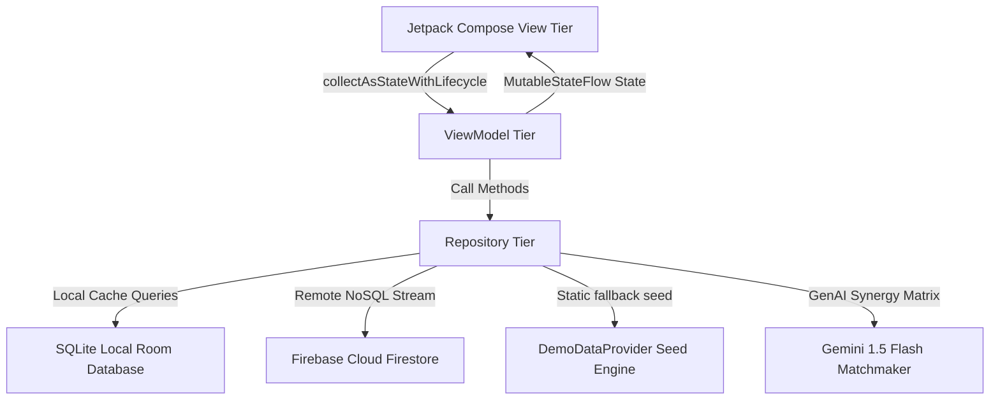

# MusicLinkd Master Architecture & Ecosystem Specifications (`docs/Architecture.md`)

This is the single authoritative source of truth for the product specifications, system architecture, database schemas, local-remote synchronization systems, security guidelines, push notifications, performance benchmarks, and release governance powering the **MusicLinkd** ecosystem (`app.musiclinkd.com`).

---

## 📋 1. Product Requirements (PRD), Personas, & Features

MusicLinkd is a specialized network and marketplace for the music industry, designed to seamlessly connect artists, vocalists, producers, audio engineers, recording studios, and venues.

### Supported User Roles
- **Musician / Singer:** Showcases creative bios, vocal ranges, instrument proficiencies, and portfolio STEM tracks.
- **Music Producer:** Explores, connects with vocalists, and reviews audio stems for active projects.
- **Sound Engineer:** Offers mixing, mastering, and engineering services to artists and recording facilities.
- **Band / Group:** Recruits members and books live venue showcase spaces.
- **Recording Studio:** Lists spatial room dimensions, SSL/Neve gear consoles, custom schedules, and books studio blocks.
- **Venue / Organizer:** Lists stage dimensions, local sound specifications, and hires active live performers.

### Core Functional Modules
1. **Discover Feed & AI Synergy Matchmaker:** Displays nearby creative talent and utilizes Gemini 1.5 Flash to evaluate natural-language portfolios and display matching synergy scores (e.g., 94% Synergy Match).
2. **Audio Portfolio Showcase:** Integrates high-fidelity audio playback of individual instrument STEMs with real-time waveform visualization powered by Jetpack Media3.
3. **Recording Studio Booking Engine:** Multi-step studio schedule picker coordinating hourly booking states, rates, and conflict-preventing locks.
4. **Peer Direct Messaging:** Real-time text communications, file sharing, and mutual collaboration "Connect" request state management.

---

## 🏛️ 2. System Architecture & Package Layout

MusicLinkd enforces strict **Clean Architecture** combined with **MVVM (Model-View-ViewModel)** to separate the application into robust, decoupled, and testable layers.



### Kotlin Package Structure (`app/src/main/java/com/example/onboarding/`)
- **`ai/`:** `GeminiMatchmaker`: Orchestrates natural-language portfolio matching queries via the REST API.
- **`api/`:** REST utilities and integration helpers.
- **`audio/`:** `WaveformAudioPlayer`: Coordinates ExoPlayer state handling and visual audio waveform bars.
- **`database/`:** `AppDatabase` (Room SQLite caching), `FirebaseManager` (real-time Firestore read/write streams).
- **`messaging/`:** `AppNotificationManager`: Configures local channels and intercepts FCM notifications.
- **`models/`:** Strict Kotlin data classes (`DemoArtist`, `DemoStudio`, `DemoTrack`, `DemoFeedPost`, `MediaAttachmentItem`).
- **`ui/components/`:** `UnifiedComponents.kt`: Highly-polished Material Design 3 design system widgets.
- **`ui/screens/`:** Feature Screen Composables (`DiscoverScreens`, `PortfolioScreens`, `MessagingScreens`, `StudioBookingScreens`).
- **`util/`:** `DemoDataProvider`: Central database seed engine ensuring state consistency.
- **`viewmodel/`:** ViewModels (`AuthViewModel`, `DiscoverViewModel`, `MessagingViewModel`, `PortfolioViewModel`).

### Navigation & Routing State Machine
MusicLinkd avoids route-parser serialization overhead by managing primary layouts via sealed navigation states (`AppTabScreen`) coupled with explicit state hoisting:
- **Primary Tabs:** `Discover` (Main Feed), `Messages` (Chat Threads), `Studios` (Recording Blocks), `Portfolio` (My Workspace), `Profile` (Settings).
- **Dynamic Overlays:** Bottom sheets and full-screen detail modals (e.g., `selectedArtistId: String?`, `selectedStudioId: String?`) are driven by nullable state variables inside ViewModels, ensuring instant restoration and zero screen flicker.

---

## 🗄️ 3. Hybrid Database Schemas & Firebase Integration

MusicLinkd implements an offline-first data synchronization framework combining a local Room SQLite cache with remote Firestore NoSQL collections.

### Local Room Caching Schemas (`AppDatabase`)
- **`user_profile_cache` Table:**
  - `id: String` (Primary Key)
  - `name: String`, `primaryRole: String`, `bio: String`, `avatarUrl: String`
  - `genresJson: String` (Serialized string array)
  - `isVerified: Boolean`, `rating: Double`, `reviewCount: Int`
- **`messages_cache` Table:**
  - `id: String` (Primary Key)
  - `conversationId: String` (Indexed)
  - `senderId: String`, `messageText: String`, `timestamp: Long`, `isPendingSync: Boolean`
- **`schedules_cache` Table:**
  - `id: String` (Primary Key)
  - `studioId: String` (Indexed)
  - `startTime: Long`, `endTime: Long`, `isBooked: Boolean`

### Remote Cloud Firestore Structures
- **`users` Collection:** Document structured mirroring domain data classes.
- **`conversations` Collection:** Sub-collection of individual active peer-to-peer messages.
- **`studios` Collection:** Document highlighting equipment specs, hourly rates, and photos.
- **`bookings` Collection:** Tracks active session calendar reservations and payment status.

### Authoritative Firebase Integration Coordinates
- **Project ID:** `musiclinkd-7ae30`
- **Sender ID / Project Number:** `846160129456`
- **Storage Bucket:** `musiclinkd-7ae30.firebasestorage.app`
- **Active Android App ID:** `1:846160129456:android:b204e38af5c6891a` (Correct valid-format hex suffix)
- **Active Web App ID:** `1:846160129456:web:c92e521e7f211308f03a75`

> **Local Emulator Crash Guard:** Programmatic startup initializers in `MusicLinkdApplication.kt` enforce `analytics.setAnalyticsCollectionEnabled(false)` and `crashlytics.setCrashlyticsCollectionEnabled(false)` when compiling on development environments to completely suppress GMS initialization warnings.

---

## ☁️ 4. Resilient Synchronization, Repositories, & Sync

All data repositories implement the **Double Cache** repository pattern. Read operations listen to localized Room data streams, which automatically emit new states when remote Firestore listeners push server mutations.

```
Write Path:   UI State Change ──> Room Cache [Pending Marker] ──> Background Sync Worker ──> Remote Firestore NoSQL
Read Path:    UI Component <── [Observes flow] ── SQLite Room Cache <── [Remote Listeners] ── Firestore Server
```

### Direct Peer Collaboration Request State Machine
Peer-to-peer connections adhere to a strict double-opt-in handshake protocol:
1. **`IDLE` ("Connect"):** No active request exists.
2. **`PENDING_SENT` ("Requested"):** Sender transmits connection request; Firestore document is generated with state `PENDING`.
3. **`PENDING_RECEIVED`:** Target user receives notification; UI displays "Accept Connection".
4. **`CONNECTED` ("Connected"):** Target accepts request; Firestore document state changes to `ACCEPTED`. Room cache refreshes automatically.

### Resilient Messaging Sync Queue
1. **Offline Write Caching:** Outgoing messages are instantly committed to local SQLite with `isPendingSync = true`.
2. **Resilient Sync Retries:** A background scheduler monitors connectivity. Upon network recovery, pending local entries are pushed sequentially to Firestore using an exponential backoff retry loop (starting at 2s up to 60s max delay).
3. **State Resolution:** Upon successful remote write, `isPendingSync` is updated to `false` in SQLite, triggering an immediate UI update.

---

## 🔔 5. Push Notifications, Animations, & Micro-interactions

### Firebase Cloud Messaging (FCM) Payload Schema
FCM JSON notifications must conform to standard structural formats to be parsed by `AppNotificationManager`:
```json
{
  "message": {
    "token": "target_device_token",
    "notification": {
      "title": "New Collab Request! 🎵",
      "body": "Producer Alex wants to collaborate on your latest stem track."
    },
    "data": {
      "click_action": "COLLAB_REQUEST",
      "senderId": "artist_uuid_100",
      "conversationId": "chat_uuid_200"
    }
  }
}
```

### Screen Transitions & Micro-animations
- **Horizonal Screen Slide:** Screen changes in the navigation backstack slide horizontally (slide in from right, slide out to left) paired with quick alpha fades using custom Jetpack Compose `EnterTransition` / `ExitTransition`.
- **Waveform Visualizer Physics:** Equalizer visualizer bars animate heights dynamically using `rememberInfiniteTransition()` containing customized floating sine and cosine wave math to match sound frequencies without taxing CPU rendering performance.
- **Button Micro-interactions:** Buttons toggle scale coordinates (e.g., bouncing smoothly from `1.0` to `1.15` and settling to `1.0` within `150ms`) upon selection clicks.

---

## 🛡️ 6. Security, Android Ergonomics, Telemetry, & QA

### Comprehensive Security Framework
- **API Key Safeguards:** All external keys (such as `GEMINI_API_KEY`) are loaded securely via build configurations (`BuildConfig`) rather than being hardcoded.
- **Firestore Security Rules:** Writing to `/users/{uid}` and `/bookings/{bookingId}` is strictly restricted to authenticated users matching the targeted payload `auth.uid`.
- **Alphanumeric Sanitization:** User registration forms sanitize name strings using strict alphanumeric regex (`^[a-zA-Z0-9 ]+$`) and limit bios to a maximum of 300 characters to prevent database injection or overflow layout crashes.

### Android Native UI Standards
1. **Edge-to-Edge Execution:** Mandates edge-to-edge layouts via `enableEdgeToEdge()` in `MainActivity` coupled with strict safe window insets (`Scaffold(contentWindowInsets = ...)`).
2. **Interactive Touch Precision:** Minimum interactive dimension sizing of **`48.dp x 48.dp`** is strictly enforced.
3. **Accessibility Screen-Reader Semantics:** Purely decorative illustrations or background gradients pass `null` as their `contentDescription`. All functional components, icons, and progress arcs declare explicit accessibility labels.

### Telemetry & Analytics Taxonomy
The telemetry subsystem utilizes non-blocking, asynchronous dispatch loops to log user interactions:
- **`collab_request` Event:** Logged when a user initiates or accepts a peer connection.
- **`media_played` Event:** Tracks audio playback length, tracks, and genre classifications.
- **`booking_success` Event:** Logs successful booking confirmations, hours booked, and targeted studios.

### Release Governance & Production Build Commands
Prior to triggering release candidates, developers must run local JVM tests and generate clean release binaries:
- **Run verification unit & screenshot tests:**
  ```bash
  gradle :app:testDebugUnitTest
  gradle :app:verifyRoborazziDebug
  ```
- **Compile production release binary (APK/AAB):**
  ```bash
  gradle :app:assembleRelease
  ```
