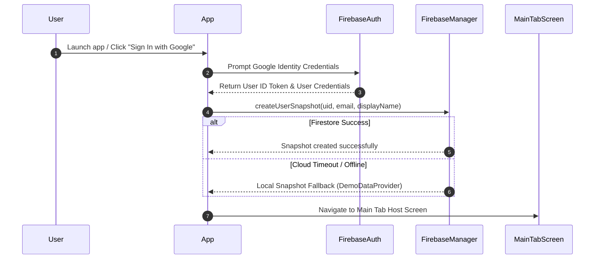
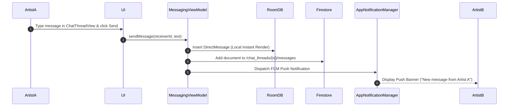
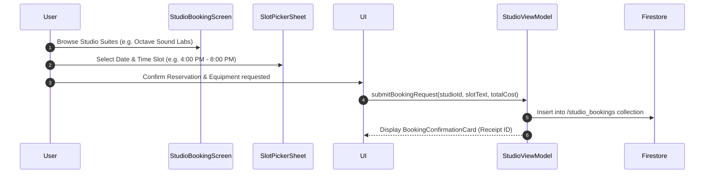
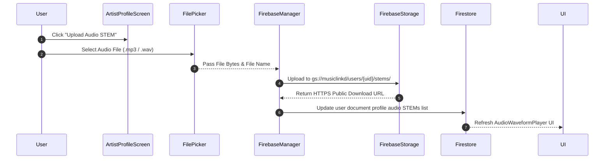

# Core Flow Diagrams — MusicLinkd User & System Flows

## 1. Authentication Flow (`Auth_Flow_Diagram.md`)

---

## 2. Direct Messaging Flow (`Messaging_Flow_Diagram.md`)

---

## 3. Studio Session Booking Flow (`Booking_Flow_Diagram.md`)

---

## 4. Media Upload Flow (`Media_Upload_Flow_Diagram.md`)

